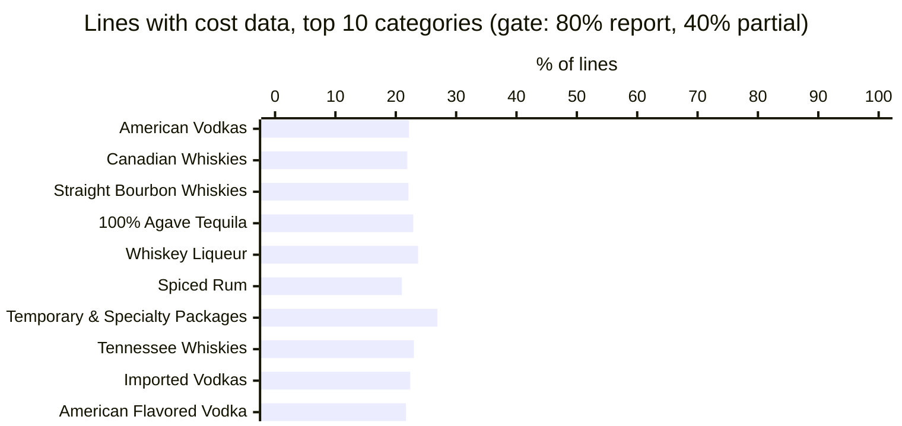
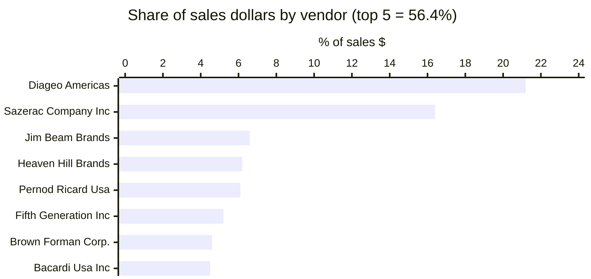
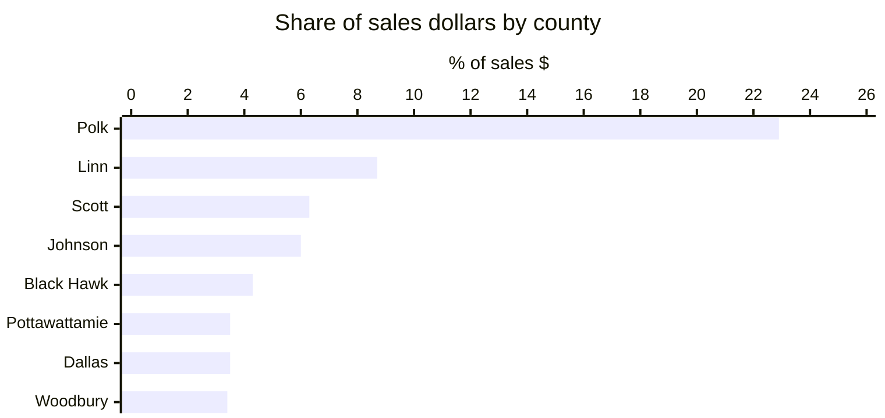

# Commercial Insights Analyst Workbench

A SQL workbench that runs the weekly reporting cycle of a BI / category insights analyst on a real 5.69M-line invoice extract: data-quality checks, certified weekly marts, category and county scorecards, a margin-coverage gate, vendor concentration, anomaly flags, and a stakeholder memo.

## The question

Given a messy two-year invoice extract, what is safe to report this week, what isn't, and what should the business do about the gaps?

## Key findings

1. **Margin can't be reported yet.** 77.6% of invoice lines have no cost or retail price. 2024 has 0% coverage and 2025 about 51% of lines. All 20 top categories (86% of sales dollars) fall below the 40% coverage floor, so every one is gated `do_not_report_margin`.
2. **Five vendors hold 56% of sales dollars (about $553M of $981M).** Diageo (21.2%) and Sazerac (16.4%) alone are 37.6%.
3. **Polk County is 22.9% of sales**, so any statewide average is mostly a Polk number.
4. **The final week (2025-12-29) shows drops of up to 63%** (Scotch −63%, Straight Bourbon −52%). They line up with a short year-end week, so they are flagged for review, not reported as a demand fall.
5. **`invoice_id` repeats on 25% of lines**, so it is not a unique key. Invoice-level reconciliation waits until the data owner confirms the grain.





## Recommendation

| Decision | Why | Trade-off |
|---|---|---|
| Publish sales, mix and coverage this week; hold margin | About $659M of top-category sales has no cost data, so any margin figure would describe roughly a fifth of the business | Category managers lose a KPI they want until the feed is fixed |
| Ask the data owner to backfill 2024 cost and retail | It is the single fix that moves categories from "do not report" towards the 80% threshold | Depends on another team's backlog |
| Keep vendor concentration on the standing pack | Two suppliers control 37.6% of dollars; a supply or pricing issue at either moves the whole category | Adds a page to the weekly pack |
| Report statewide KPIs with and without Polk County | Stops one county's mix from passing as a state trend | Two numbers to explain instead of one |
| Compare full ISO weeks only | Partial weeks create false alarms like the 2025-12-29 drops | Results arrive one week later |

## Data

| | |
|---|---|
| Source | [Iowa Data Hub, Iowa Liquor Sales](https://data.iowa.gov/catalog/dataset/1051), 2024 and 2025 extracts |
| Size | ~5.69M invoice lines, 2,353 stores |
| Licence | CC BY 4.0 (State of Iowa, Department of Revenue); see `DATA_LICENSE.md` |

Raw CSVs are not committed. `scripts/download_data.py` fetches them.

## Method

| Step | File | What it does |
|---|---|---|
| 1 | `sql/00_load.sql` | Loads the period extract into DuckDB |
| 2 | `sql/01_dq_checks.sql` | Exception report: row counts, duplicate keys, missing fields |
| 3 | `sql/02_clean_views.sql` | Typed staging views |
| 4 | `sql/03_mart_weekly_sales.sql` | Certified weekly sales mart |
| 5 | `sql/10–14_*.sql` | Scorecards, margin gate (80% / 40% line coverage), vendor concentration, week-over-week flags |
| 6 | `docs/metric-dictionary.md`, `findings/weekly_insights_memo.md` | Metric definitions and the stakeholder memo |

## How to run

```bash
python3 -m pip install -r requirements.txt
python3 scripts/download_data.py
python3 scripts/run_pipeline.py --export-samples
```

## Limitations and next steps

- These are wholesale invoices to licensed retailers, not shelf-scan POS data. The reporting process transfers to a Canadian retailer; the spirits findings don't.
- State bottle cost and retail are not true store margin.
- The year-end week distorts week-over-week comparisons.
- Next: add a Tableau Public version of the scorecard, and re-run once 2024 cost data is backfilled.

## Author

Lavanya Kumar · Bachelor of Data Science (Honours), York University, graduating April 2027 · [GitHub](https://github.com/Lrk777) · [LinkedIn](https://www.linkedin.com/in/lavanya-kumar-610a07214)
